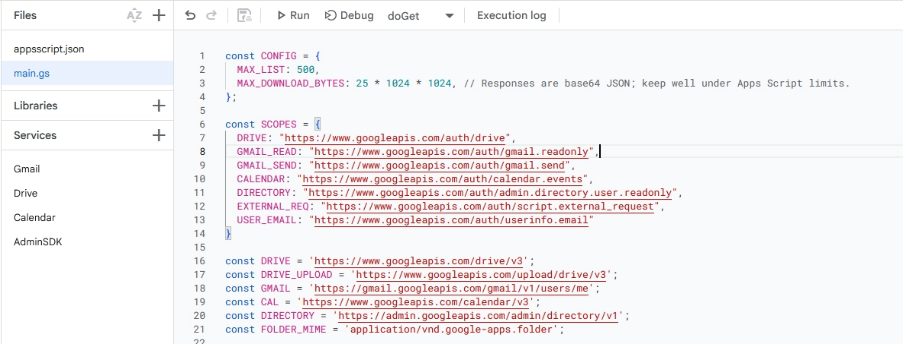
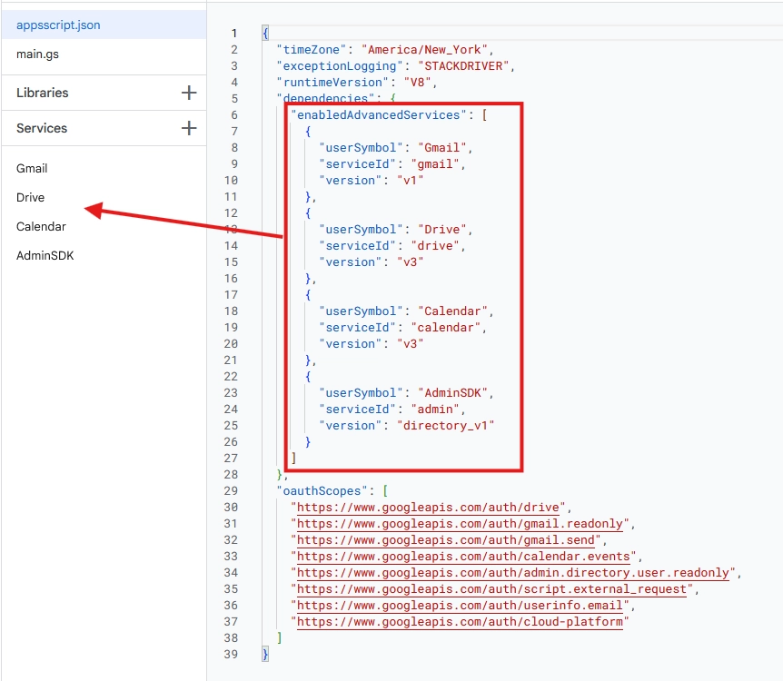
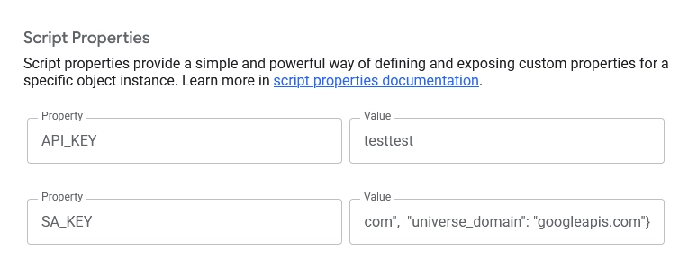
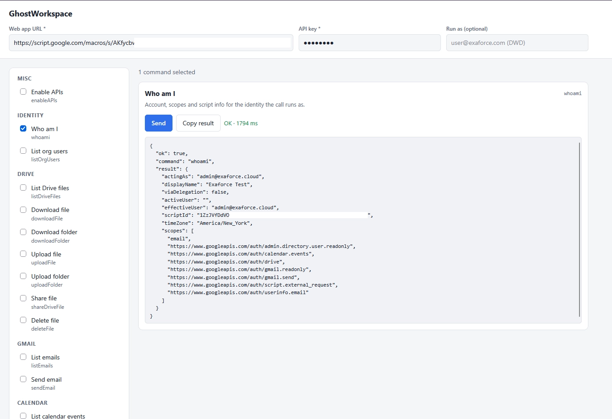
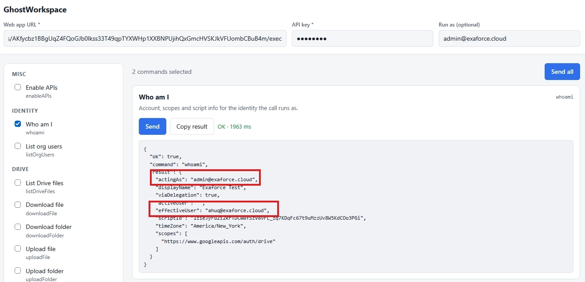

# GhostWorkspace

To make these techniques concrete and give defenders something to test against, I built **GhostWorkspace**, a proof-of-concept that turns a single Apps Script deployment into a backdoor for a Workspace tenant. The script exposes a web deployment and waits for the requests with the operation to run. The `COMMANDS` list contains the command string to the function that handles it.

```jsx
const COMMANDS = {
  whoami,
  listDriveFiles,
  listEmails,
  listOrgUsers,
  listCalendarInvites,
  createCalendarRecord,
  deleteCalendarRecord,
  sendEmail,
  downloadFile,
  downloadFolder,
  uploadFile,
  uploadFolder,
  shareDriveFile,
  deleteFile,
  enableAPIs
};
```

Those commands fall into a few groups that map directly to the built-in services covered earlier:

- **Reconnaissance:** `whoami` confirms which identity the code is running as, and `listOrgUsers`, `listDriveFiles`, `listEmails` and `listCalendarInvites` enumerate the account and its surrounding tenant.
- **Data movement:** `downloadFile` / `downloadFolder` pull content out, `uploadFile` / `uploadFolder` stage content in, and `shareDriveFile` re-permissions existing files. Because the traffic terminates on `script.google.com`, it blends into ordinary Workspace activity rather than standing out as exfiltration to an unknown host.
- **Action as the user:** `sendEmail` sends mail under the victim’s identity, and `createCalendarRecord` / `deleteCalendarRecord` manipulate the calendar.
- **Cleanup and reach:** `deleteFile` removes artifacts the operator leaves behind, and `enableAPIs`  turns on API services in the project to allow the script to execute them.


## Set-up

To setup, access to script.google.com is needed for the compromised user. This can be achieved through getting access to their account through session hijacking, which can be achieved through phishing attacks such as Adversary-In-The-Middle phishing. Currently, there is no programmatic way of 

On script.google.com, a new project needs to be created, where the code inside the directory **back-end** from **GhostWorkspace** can be uploaded. The two files from the directory are the metadata file `appsscript.json`, and the code of the backdoor `main.js`.



`appsscript.json` contains a list of scopes the app needs and API Services which need to be enabled. When the file is added, the service APIs are enabled by default, but the scopes will require authorization by the user owning the app.



The script needs an API Key, which is just a parameter to allow the script to know the requester is the attacker and not some other entity. The `API_KEY` value can be anything. 

If the DWD route is chosen, the attacker needs to add the Service Account and scopes to DWD configurations as seen previously and provide the SA JSON Key on the variable `SA_KEY`.



## UI Interface

Upon setting up the back-end backdoor, it can be accessed through a front-end single HTML/CSS/JS web page. The front-end can be hosted everywhere, as long as it has access to request the Apps Scripts (URL on endpoint `https://script.google.com/macros`).

It will require the `API_KEY` value defined before to validate the ownership of the script. Upon providing them, it will allow execution of the tasks.



If DWD is configured, it will only request the email of the target user to impersonate and execute tasks on their behalf.


